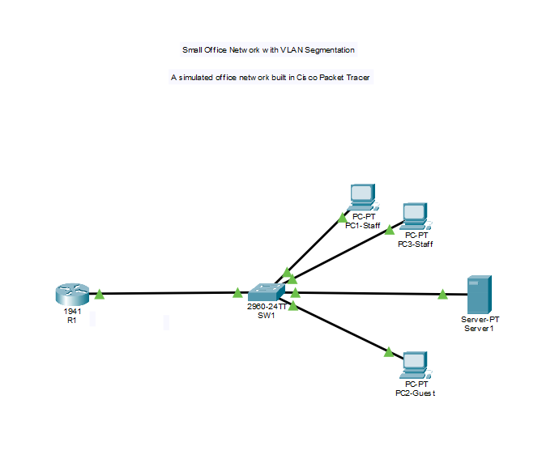
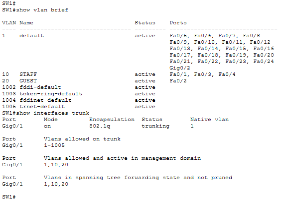
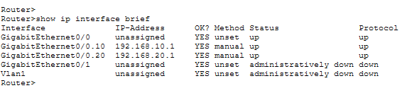
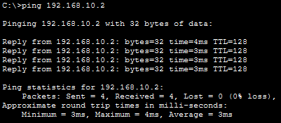
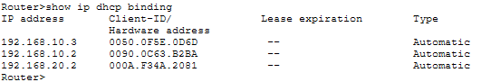
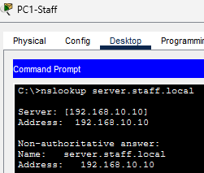
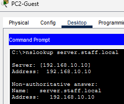
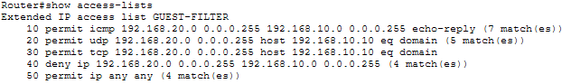
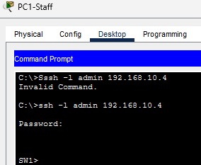
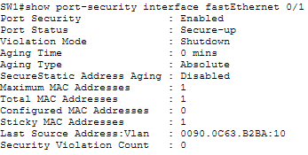

# VLAN Segmentation and Network Security Lab

## Project Overview

This project demonstrates the design, configuration, and testing of a small-business network using Cisco Packet Tracer. The network separates Staff and Guest devices into different VLANs, enables inter-VLAN routing, provides automatic IP address assignment and DNS resolution, and implements access controls to restrict communication between the two networks.

The project also implements SSH for secure remote administration and sticky MAC port security to restrict which device can use a designated switch access port.

### Objectives

- Segment Staff and Guest devices using VLANs.
- Configure IEEE 802.1Q trunking and router-on-a-stick inter-VLAN routing.
- Implement DHCP for automatic client IP configuration.
- Configure DNS and verify hostname resolution across VLANs.
- Apply an extended ACL to restrict Guest-initiated access to the Staff network while permitting required DNS queries and selected ICMP responses.
- Configure SSH for remote administration of the router and switch.
- Implement sticky MAC port security on a switch access port.
- Validate network functionality and security policies through testing.

**Tools and technologies:** Cisco Packet Tracer, Cisco IOS CLI, VLANs, IEEE 802.1Q, inter-VLAN routing, DHCP, DNS, extended ACLs, SSH, and switch port security.

## 1. Network Topology

**Figure 1. Overall Network Topology**

The network consists of one 1941 Cisco router, one Cisco 2960 switch, three client PCs, and one server. The router provides inter-VLAN routing and DHCP services, while the server provides DNS resolution.

The router connects to the switch through an IEEE 802.1Q trunk. End devices connect through access ports assigned to their respective VLANs.

### Device and Port Connections

| Device | Interface | Connected device | Purpose |
|---|---|---|---|
| R1 | G0/0 | SW1 G0/1 | 802.1Q trunk |
| SW1 | Fa0/1 | PC1 | Staff access port |
| SW1 | Fa0/2 | PC2 | Guest access port |
| SW1 | Fa0/3 | PC3 | Staff access port |
| SW1 | Fa0/4 | DNS Server | Server access port in VLAN 10 |

### VLAN and IP Addressing Plan

| VLAN | Name | Network | Purpose |
|---|---|---|---|
| 10 | STAFF | `192.168.10.0/24` | Staff clients, switch management, and DNS server |
| 20 | GUEST | `192.168.20.0/24` | Guest clients |

The router uses separate subinterfaces to provide a default gateway for each VLAN.

| Device/interface | IP address | Addressing method |
|---|---|---|
| R1 G0/0.10 | `192.168.10.1/24` | Static |
| R1 G0/0.20 | `192.168.20.1/24` | Static |
| SW1 VLAN 10 SVI | `192.168.10.4/24` | Static |
| DNS Server | `192.168.10.10/24` | Static |
| PC1 — Staff | `192.168.10.2/24` | DHCP, observed lease |
| PC3 — Staff | `192.168.10.3/24` | DHCP, observed lease |
| PC2 — Guest | `192.168.20.2/24` | DHCP, observed lease |

The client addresses shown are the leases observed during testing. DHCP may assign different addresses in future sessions.

**Figure 2. VLAN and Trunk Verification**

## 2. Technical Implementation

### 2.1 VLANs and 802.1Q Trunking

Two VLANs were created to separate Staff and Guest devices into distinct Layer 2 broadcast domains.

- VLAN 10 — STAFF
- VLAN 20 — GUEST

Switch access ports were assigned according to the connected devices. The link between SW1 and R1 was configured as an 802.1Q trunk to carry traffic for both VLANs.

VLAN segmentation separates the two groups at Layer 2, while trunking allows multiple VLANs to share a physical link between the switch and router.

### 2.2 Inter-VLAN Routing

Router-on-a-stick was implemented on R1 using two subinterfaces:

- `G0/0.10` — `192.168.10.1/24`
- `G0/0.20` — `192.168.20.1/24`

Each subinterface handles traffic for its corresponding VLAN. The router enables communication between the VLANs, subject to the configured access-control policy.

**Figure 3. Inter-VLAN Routing Verification**

`[ip interface brief]`

`[VLAN 10 to VLAN 20 ping]`

### 2.3 DHCP

DHCP pools were configured on R1 to automatically assign network settings to Staff and Guest clients.

Each pool provides:
- An IP address from its respective subnet.
- The appropriate default gateway.
- The DNS server address `192.168.10.10`.

The router excludes the gateway addresses, switch management address, and DNS server address from DHCP assignment.

So the DHCP simplifies client configuration and helps prevent address conflicts with statically addressed infrastructure devices.

**Figure 4. DHCP Verification**

`[ip dhcp binding]`

### 2.4 DNS

A server with the static address `192.168.10.10` was configured to provide DNS resolution. The following DNS A record was created:

| Hostname | Record type | Resolved address |
|---|---|---|
| `server.staff.local` | A | `192.168.10.10` |

DNS resolution was tested from both Staff and Guest clients using `nslookup`. Both clients successfully resolved the hostname to the expected address.

DNS allows clients to use a hostname instead of having to remember the server's IP address.

**Figure 5. DNS Resolution**

`[vlan10 nslookup]`

`[vlan20 nslookup]`

### 2.5 Extended ACL — Guest Access Restrictions

An extended ACL named `GUEST-FILTER` was applied inbound to R1's `G0/0.20` subinterface.

The policy restricts Guest-initiated traffic toward the Staff subnet while permitting DNS queries to the designated server and selected ICMP echo-reply traffic.

| Rule | Action | Purpose |
|---|---|---|
| ICMP echo-reply from Guest to Staff | Permit | Allows replies to Staff-initiated pings |
| UDP DNS from Guest to `192.168.10.10` | Permit | Allows DNS queries over UDP |
| TCP DNS from Guest to `192.168.10.10` | Permit | Allows DNS queries over TCP |
| Other Guest-to-Staff traffic | Deny | Restricts Guest-initiated access to the Staff subnet |
| Other traffic | Permit | Allows traffic not matched by preceding rules |

The order of ACL entries is important because the router evaluates rules sequentially and applies the first matching rule.

Testing confirmed that Staff-to-Guest ping succeeded while Guest-to-Staff ping was blocked. Guest clients could still resolve the DNS hostname because DNS traffic was explicitly permitted.

**Figure 6. ACL Configuration and Verification**

`[access-list GUEST-FILTER]`

### 2.6 Secure Remote Administration with SSH

SSH was enabled on SW1 to support encrypted remote administration.

SW1 was assigned the management IP `192.168.10.4/24` on its VLAN 10 switched virtual interface, with `192.168.10.1` configured as its default gateway.

SW1 was configured for SSH-based access using local user authentication and privileged EXEC authentication. SSH encrypts remote-management traffic, unlike unencrypted remote-access protocols and remote SSH access from PC1 to SW1 was tested successfully.

**Figure 7. SSH Management Verification**

`[SSH access from PC1 to SW1]`

### 2.7 Switch Port Security

Sticky MAC port security was configured on SW1's `FastEthernet0/1`, the access port connected to PC1.

The configuration allows one secure MAC address and automatically learns the connected device's MAC address. The violation mode was set to `shutdown`, which was already set by default.

| Setting | Configuration |
|---|---|
| Interface | Fa0/1 |
| Maximum secure MAC addresses | 1 |
| MAC learning | Sticky |
| Violation action | Shutdown |

The switch learned PC1's MAC address, `0090.0C63.B2BA`. The port-security violation behavior was tested, and the port was restored after the test.

Port security restricts which MAC address can use the designated access port, helping reduce unauthorized device connections.

**Figure 8. Port Security Verification**

`[port security interface]`

## 3. Testing and Results

The network was tested to verify that its services and access-control policies behaved as intended.

| Test | Expected result | Observed result | Status |
|---|---|---|---|
| PC1 to Staff gateway | Ping succeeds | Successful | PASS |
| PC1 to PC2 | Ping succeeds | Successful | PASS |
| PC2 to PC1 | Ping blocked | Blocked as intended | PASS |
| Staff DHCP | Correct subnet and gateway assigned | Correct leases observed | PASS |
| Guest DHCP | Correct subnet and gateway assigned | Correct lease observed | PASS |
| DNS lookup from PC1 | Resolves to `192.168.10.10` | Successful | PASS |
| DNS lookup from PC2 | Resolves to `192.168.10.10` | Successful | PASS |
| SSH from PC1 to SW1 | Remote login succeeds | Successful | PASS |
| Fa0/1 port security | One sticky MAC permitted; violation triggers shutdown | Tested successfully; port restored | PASS |

The observed results matched the intended network policy. Staff could initiate a ping to Guest, while Guest-initiated ICMP traffic to Staff was blocked. Guest clients could still resolve the DNS hostname.

## 4. Key Learning Outcomes

Through this project, I practiced:

- Designing a segmented network using VLANs and an 802.1Q trunk.
- Configuring router-on-a-stick inter-VLAN routing.
- Deploying DHCP and DNS services and verifying client connectivity.
- Developing and troubleshooting extended ACLs based on a traffic policy.
- Configuring SSH for remote administration of Cisco devices.
- Implementing sticky MAC port security and testing violation handling.
- Validating network behavior through CLI commands, client-side tests, and observed results.

## 5. Project Files

- `VLAN-Segmentation-ACL-SSH-Lab.pkt` — Cisco Packet Tracer project.
- `screenshots/` — Screenshots supporting the topology, configuration, and test results.
- `configs/` — Sanitized device configuration extracts.
- `docs/` — Detailed configuration procedures and troubleshooting notes.

---

**Author:** `Allen Tan`  
**Project type:** Networking / Network Security Lab  
**Platform:** Cisco Packet Tracer 9.0.1  
**Status:** Completed and tested
